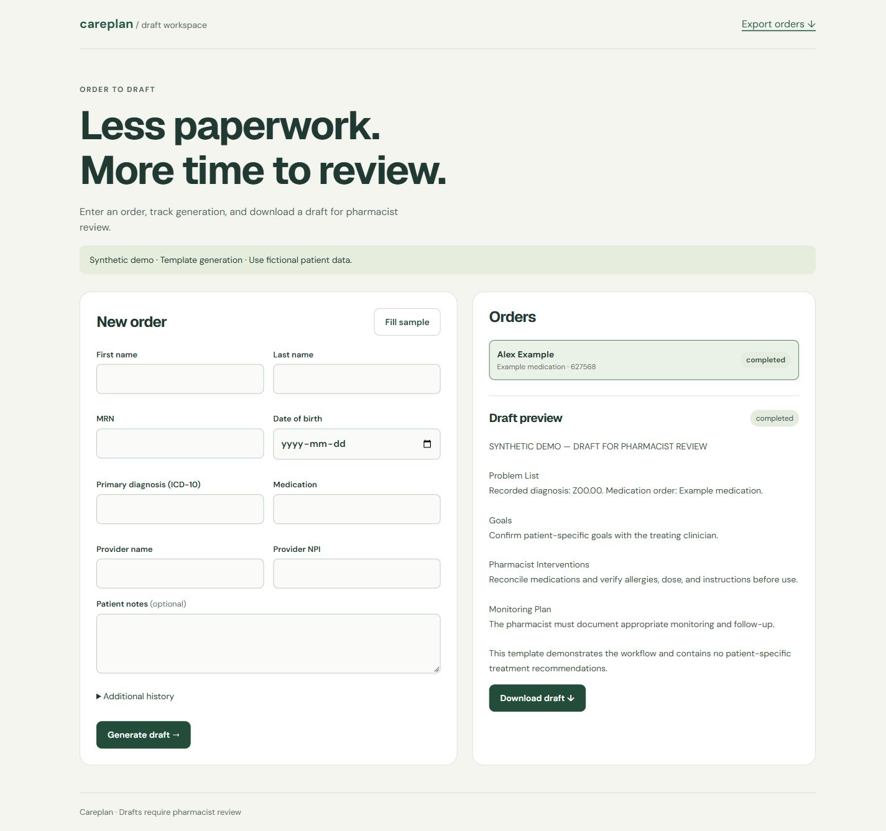
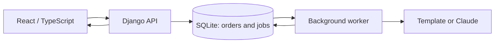

# Careplan

Careplan accepts medication orders, generates care-plan drafts in a background worker, and provides a web interface for review and download.

**React · TypeScript · Django · Python · SQLite · AWS Lambda · DynamoDB · SQS · Terraform**

## Application

Order intake and draft review. This example uses sample data and the local template generator.



The form validates patient identifiers, diagnosis codes, and provider details before saving an order. Duplicate orders are blocked; changes to an existing patient's details and refills require confirmation.

Submitted orders appear in the order list with their generation status. Completed drafts can be previewed and downloaded as text. Order history can be exported as CSV.

The API accepts web-form JSON, clinic JSON, and pharmacy XML through a shared adapter layer.

## Architecture



Django serves the React build and stores orders and jobs in SQLite. A separate worker claims each job with a three-minute lease. Failed jobs retry after 10 and 20 seconds; after the third failure, the user can retry from the order list. Jobs with expired leases can be picked up by another worker.

The AWS backend uses API Gateway, Lambda, DynamoDB, and SQS. It is deployed separately from the Django app. See [AWS deployment](infra/aws/README.md).

## Run locally

Requires Python 3.12+, Node.js 22.12+, and pnpm. Commands below use PowerShell from the repository root.

```powershell
python -m venv .venv
.venv/Scripts/python.exe -m pip install -r backend/requirements.txt
.venv/Scripts/python.exe backend/manage.py migrate
cd frontend
pnpm install
pnpm build
cd ..
.venv/Scripts/python.exe backend/manage.py runserver 127.0.0.1:8000
```

Start the worker in a second terminal from the repository root:

```powershell
.venv/Scripts/python.exe backend/manage.py worker
```

Open [localhost:8000](http://127.0.0.1:8000) and select **Fill sample**, then **Generate draft**. The default mode uses a local template and does not require an API key.

For frontend development, run `pnpm dev` in `frontend/`. Vite proxies API requests to Django.

### Claude configuration

Set the following in the worker terminal before starting it:

```powershell
$env:CAREPLAN_MODE = 'claude'
$env:ANTHROPIC_API_KEY = '<your API key>'
$env:ANTHROPIC_MODEL = '<available model ID>'
.venv/Scripts/python.exe backend/manage.py worker
```

Also set `CAREPLAN_MODE=claude` in the Django terminal. Only the worker needs the API key.

## API

| Method | Endpoint | Purpose |
| --- | --- | --- |
| GET | `/api/health` | Active mode and CSRF bootstrap |
| GET / POST | `/api/orders` | List or submit orders |
| GET | `/api/orders/{id}` | Order status and draft |
| POST | `/api/orders/{id}/retry` | Retry a failed order |
| GET | `/api/orders/{id}/download` | Download the draft as text |
| GET | `/api/orders/export` | Export order history as CSV |

Submission supports `?source=web_form`, `?source=clinic_json`, and `?source=pharma_xml`. Example payloads are in [backend/samples](backend/samples). Mutating browser requests require a CSRF token.

## Tests

```powershell
.venv/Scripts/python.exe backend/manage.py test orders
.venv/Scripts/python.exe backend/manage.py check
.venv/Scripts/python.exe -m pip install -r infra/aws/requirements.txt
.venv/Scripts/python.exe -m unittest discover -s infra/aws/tests -v
cd frontend
pnpm build
```

Tests cover generation and download, input validation, duplicates, provider conflicts, warning confirmation, failure and retry, CSRF enforcement, and queue redelivery behavior.

## Limitations

The SQLite worker runs on a single machine. The app has no authentication; use sample data when running it locally. Drafts require pharmacist review. PDF parsing and external registry lookups are not implemented.
