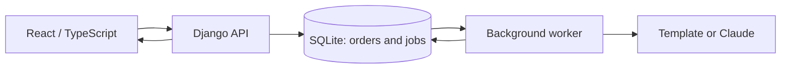

# Careplan

An asynchronous care-plan drafting application with structured order intake, background generation, and a review workspace.

**React · TypeScript · Django · Python · SQLite · AWS Lambda · DynamoDB · SQS · Terraform**

## Demo

Submit an order, follow its status, preview the generated draft, and download it for pharmacist review. The screenshot below shows the running application with fictional data and the built-in template generator.


1. Select **Fill sample** to populate a fictional order.
2. Select **Generate draft**. The background worker processes the order while the workspace tracks its status.
3. Open the completed order to review and download the draft. Use **Export orders** for CSV export.

## Features

- Structured patient, medication, diagnosis, and provider intake with field validation.
- Same-day duplicate prevention, provider-conflict detection, and confirmation for patient identity differences or refills.
- Durable background jobs with worker leases, delayed retries, and explicit retry after failure.
- Order history, status polling, draft preview, text download, and CSV export.
- Shared adapters for web-form JSON, clinic JSON, and pharmacy XML.
- AWS implementation with API Gateway, Lambda, DynamoDB, SQS, a dead-letter queue, and CloudWatch alarms.

## Architecture



The local application serves the built frontend through Django. Orders and jobs persist in SQLite; a separate worker claims jobs atomically with a three-minute lease. Failed attempts wait 10 and 20 seconds before retrying. After three attempts, an order can be retried from the workspace. Expired leases allow recovery after a worker interruption.

The AWS implementation uses a separate serverless API and queue-backed generation path. See [AWS deployment](infra/aws/README.md) for configuration and operation.

## Project structure

```text
careplan-project/
├── backend/
│   ├── careplan/           # Django configuration and URL routing
│   ├── orders/             # API, models, validation, generation, worker, tests
│   ├── shared/             # Intake adapters shared with Lambda
│   ├── samples/            # Synthetic JSON and XML fixtures
│   ├── manage.py
│   └── requirements.txt
├── frontend/
│   ├── src/                # React workspace and styles
│   └── package.json
├── infra/
│   └── aws/
│       ├── lambda/         # Serverless API and generation handlers
│       ├── terraform/      # Resources, IAM, queue, and monitoring
│       └── tests/          # Handler tests
├── scripts/                # Lambda packaging, benchmarking, DLQ replay
├── docs/
│   └── screenshots/        # Application screenshots
└── README.md
```

## Run locally

Requires Python 3.12+, Node.js 22.12+, and pnpm. Commands below use PowerShell from the repository root.

```powershell
python -m venv .venv
.venv/Scripts/python.exe -m pip install -r backend/requirements.txt
.venv/Scripts/python.exe backend/manage.py migrate
cd frontend
pnpm install
pnpm build
cd ..
.venv/Scripts/python.exe backend/manage.py runserver 127.0.0.1:8000
```

Start the worker in a second terminal from the repository root:

```powershell
.venv/Scripts/python.exe backend/manage.py worker
```

Open [localhost:8000](http://127.0.0.1:8000). The default demo mode needs no API credentials. For frontend development, run `pnpm dev` in `frontend/`; Vite proxies API requests to Django.

### Claude configuration

Set the following in the worker terminal before starting it:

```powershell
$env:CAREPLAN_MODE = 'claude'
$env:ANTHROPIC_API_KEY = '<your API key>'
$env:ANTHROPIC_MODEL = '<available model ID>'
.venv/Scripts/python.exe backend/manage.py worker
```

Set `CAREPLAN_MODE=claude` in the web terminal as well so the workspace displays the active mode. API credentials remain on the backend.

## API

| Method | Endpoint | Purpose |
| --- | --- | --- |
| GET | `/api/health` | Active mode and CSRF bootstrap |
| GET / POST | `/api/orders` | List or submit orders |
| GET | `/api/orders/{id}` | Order status and draft |
| POST | `/api/orders/{id}/retry` | Retry a failed order |
| GET | `/api/orders/{id}/download` | Download the draft as text |
| GET | `/api/orders/export` | Export order history as CSV |

Submission supports `?source=web_form`, `?source=clinic_json`, and `?source=pharma_xml`. Example payloads are in [backend/samples](backend/samples). Mutating browser requests require a CSRF token.

## Validation

```powershell
.venv/Scripts/python.exe backend/manage.py test orders
.venv/Scripts/python.exe backend/manage.py check
.venv/Scripts/python.exe -m pip install -r infra/aws/requirements.txt
.venv/Scripts/python.exe -m unittest discover -s infra/aws/tests -v
cd frontend
pnpm build
```

Tests cover generation and download, input validation, duplicates, provider conflicts, warning confirmation, failure and retry, CSRF enforcement, and queue redelivery behavior.

## Usage scope

The local configuration is for a single-machine demonstration with fictional data. Generated drafts require pharmacist review. Authentication, clinical deployment controls, PDF parsing, and external registry integrations are not included.
