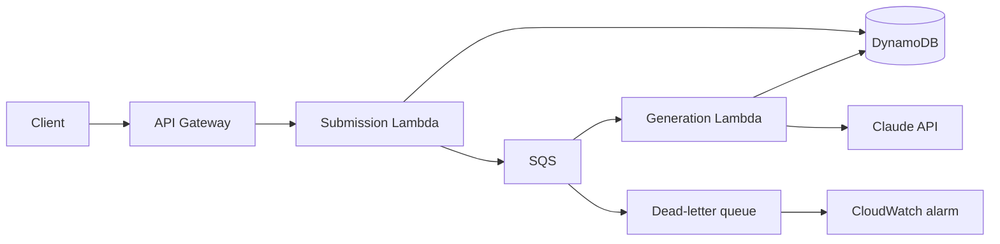

# AWS deployment

API Gateway routes order submissions to Lambda. Orders are stored in DynamoDB, and SQS queues generation jobs for a separate Lambda worker.



The React app connects to Django. To submit orders directly to the AWS API and measure completion time, use `scripts/benchmark.py --aws --url YOUR_API_URL`.

## Prerequisites

- Terraform 1.5+ and an authenticated AWS CLI profile.
- An Anthropic API key and an available Claude model ID.
- Python dependencies from `infra/aws/requirements.txt`.

Run the following from the repository root:

```powershell
.venv/Scripts/python.exe -m pip install -r infra/aws/requirements.txt
.venv/Scripts/python.exe scripts/package_aws.py
terraform -chdir=infra/aws/terraform init
terraform -chdir=infra/aws/terraform validate
```

Copy `infra/aws/terraform/terraform.tfvars.example` to `terraform.tfvars` in the same directory. Set the expected AWS account ID and model ID, then provide the API key through `TF_VAR_anthropic_api_key` in the environment. Terraform state contains sensitive Lambda configuration; store it privately.

Review the plan before deploying resources:

```powershell
terraform -chdir=infra/aws/terraform plan
terraform -chdir=infra/aws/terraform apply
```

The account guard restricts deployment to the configured account. Deployment creates billable resources.

## Intake

`POST /orders?source=web_form` accepts flat JSON; `clinic_json` accepts nested JSON; `pharma_xml` accepts XML. Example requests are in `backend/samples/`. The Lambda package includes the same adapters used by Django in `backend/shared/`.

`GET /orders/{id}` returns order status and the generated draft.

## Queue processing

- A DynamoDB transaction records the order and same-day duplicate guard.
- SQS delivers jobs to the generation worker; failed attempts use 10- and 20-second delays before final failure and dead-letter handling.
- Completed orders skip repeated generation on redelivery.
- CloudWatch alarms report visible messages in the dead-letter queue.
- Application roles restrict data access to the orders table and jobs queue. DLQ replay uses a separate operator identity.

The Terraform configuration includes an IAM probe that checks application-table access and denial on an out-of-scope table:

```powershell
aws lambda invoke --function-name careplan-drill-iam-probe probe-result.json
Get-Content probe-result.json
```

## Recovery

Fix the cause of the failure, then replay the order from the dead-letter queue:

```powershell
.venv/Scripts/python.exe scripts/replay_dlq.py --order-id YOUR_ORDER_ID --dlq-url YOUR_DLQ_URL --queue-url YOUR_QUEUE_URL --table careplan-orders
```

The replay script deletes the original message only after observing completion. It requires SQS permissions on both queues and DynamoDB `GetItem` on the orders table. Unrelated messages are returned to the queue.

If order persistence succeeds but initial queue delivery fails, the API returns `503` with the order ID. Resend `{"order_id":"..."}` to the jobs queue after resolving the queue issue.

## Cleanup

```powershell
terraform -chdir=infra/aws/terraform destroy
```
